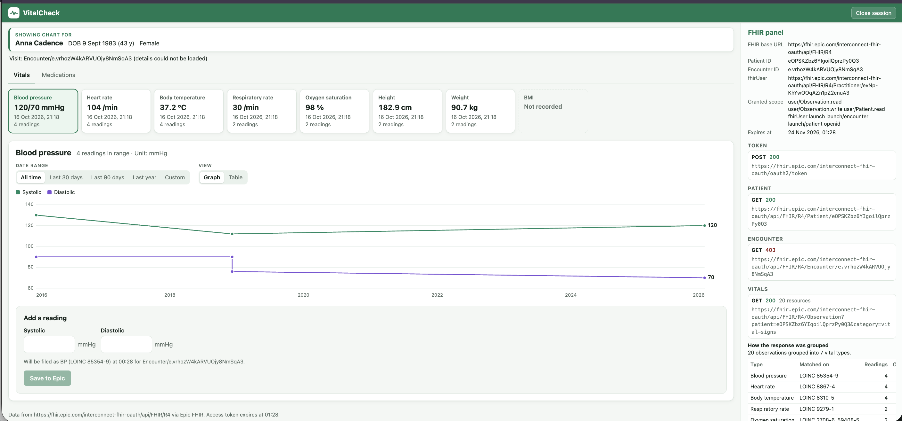

# VitalCheck: A SMART on FHIR App for Epic

> **Built with [Claude](https://claude.ai) (Anthropic)**, from a detailed specification that I wrote and drove to a working Epic integration.

VitalCheck is a clinician-facing app that runs **inside Epic**. A clinician opens it from a patient's chart, and it shows that patient's vital signs as an interactive graph and table, lists their medications, and lets the clinician record a new vital that is written straight back into the Epic chart.

*VitalCheck launched from Epic's sandbox for the test patient Anna Cadence. Vital tiles, a blood pressure trend, the add-a-reading form, and the FHIR panel (right) showing every request to Epic.*

---

## What it's for

Clinicians often want a quick, focused view of one thing, such as how a patient's blood pressure has moved across visits, without digging through flowsheets. VitalCheck is that view, delivered as a **SMART on FHIR** app: the integration standard Epic and other EHRs use to embed third-party apps in the clinical workflow.

- **No login, no patient search.** Epic hands over the patient and the visit at launch. The clinician never leaves their workflow.
- **Vitals at a glance.** Blood pressure, heart rate, temperature, respiratory rate, oxygen saturation, height, weight and BMI, each with its latest value and reading count.
- **Trends.** A hand-built SVG line chart with date-range filters, hover and keyboard readouts, and a table view.
- **Write-back.** Records a new reading as a FHIR `Observation` filed against the current encounter.
- **Medications.** Active orders first, with dosage instructions and prescriber.
- **Transparent by design.** A built-in *FHIR panel* logs every HTTP exchange with Epic (discovery, token, reads, pagination and writes), with headers and payloads, so the integration can be inspected step by step.

## How it was built on Epic on FHIR

1. **Registered the app on [fhir.epic.com](https://fhir.epic.com)** as a clinician-facing (provider) app. I chose FHIR R4 APIs for Patient, Encounter, Observation (vitals: read, search, create) and MedicationRequest, with SMART v1 scopes, `openid` and `fhirUser`, as a public client (no secret).
2. **Implemented the SMART EHR launch from scratch.** Epic opens the app with `iss` and `launch` parameters. The app discovers Epic's OAuth endpoints from `.well-known/smart-configuration`, runs **OAuth 2.0 authorization code with PKCE (S256)** using the Web Crypto API, and passes the launch token through with `aud`. Epic recognises the clinician is already signed in and returns straight to the app, with no login or consent screen.
3. **Exchanged the code for an access token** that carries the patient and encounter context, then read `Patient`, `Encounter`, `Observation?category=vital-signs` (with bundle pagination) and `MedicationRequest` directly from Epic's FHIR server.
4. **Tested end to end in Epic's sandbox** using Epic's app launcher ("Launching your app from Epic → Try It") with sandbox test patients.

## Engineering highlights

- **No OAuth or FHIR libraries.** The whole flow (PKCE, state handling, token exchange, ID-token decoding) is written with `fetch` and Web Crypto, so every step is explicit.
- **No chart library.** The vitals graph is hand-written inline SVG: a single y axis, gaps where values are missing, "nice" tick generation, a crosshair tooltip, keyboard navigation, and an `aria-live` readout.
- **Built for Epic Hyperspace.** Works in a 390px sidebar with no horizontal scroll. It uses only `sessionStorage` (no cookies or localStorage), and keys each launch by its OAuth `state` so two embedded windows for two patients can't overwrite each other. It uses no popups, iframes or new tabs.
- **Clinical data handling.** Codes are shown as human-readable text, UCUM units are displayed as clinicians write them (`mm[Hg]` → mmHg, `Cel` → °C), units are never converted, and readings in a different unit are kept out of a trend line rather than drawn as a false trend.
- **Resilient UI.** Each section fails on its own terms. A 403 on medications or an unreadable encounter never blanks the page, and Epic's `OperationOutcome` messages are shown verbatim.
- **Accessible, colour-blind-safe charting.** Series colours were checked with a colour-vision-deficiency validator. Selection state uses `aria-pressed`/`aria-selected`, and the chart is fully keyboard-operable.

## Real-world integration lessons

Working against Epic's actual sandbox surfaced issues no spec anticipated:

- **Launch tokens are single-use and app-specific.** A reused or mismatched token produces Epic's generic "OAuth2 Error" page. I isolated this by probing the authorize endpoint one parameter at a time.
- **Epic returns multiple codings per vital** (for example LOINC 85354-9, LOINC 55284-4 and an Epic flowsheet ID). Echoing them all back on create fails with *"Multiple FLO IDs provided"*. The app now sends exactly one coding copied from Epic's own data, falling back through candidates, and shows every attempt in the FHIR panel.
- **Filing vitals maps to Epic flowsheet rows.** Write-back is implemented and working through the request pipeline. Blood-pressure filing in the sandbox currently returns *"Invalid Flowsheet data"*, and I'm investigating the exact shape Epic expects for that row.
- **Granted scopes can differ from those requested.** Epic returned `user/`-level scopes and `launch/patient`/`launch/encounter` context, which the FHIR panel makes visible.

## Tech stack

**React 18 · TypeScript · Vite** · SMART App Launch (EHR launch) · OAuth 2.0 + PKCE · HL7 FHIR R4 · Epic on FHIR sandbox · inline SVG · plain CSS

Frontend only, by design: the browser talks directly to Epic, with no backend or proxy.

---

*All data shown is from Epic's public sandbox and fictional test patients. The FHIR panel deliberately exposes access tokens and raw payloads for learning. It would be removed before any use with real patient data.*
